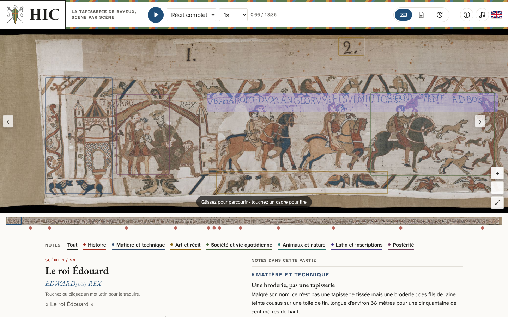

# Hic — The Bayeux Tapestry, scene by scene / La Tapisserie de Bayeux, scène par scène



**EN** · [Français plus bas](#fr)

Hic is a bilingual (English/French) web app for reading the Bayeux Tapestry the way it was made to be read: from
left to right, scene by scene. It was made by Paul Benard for the Tapestry's loan to the British Museum
(10 September 2026 – 11 July 2027), as an independent, non-commercial companion to the visit. No ads, no
cookies, no tracking.

The name comes from the Latin captions embroidered above the scenes, more than half of which begin with *hic*, "here".

## What it does

- **The whole embroidery, in deep zoom.** All 58 scenes on the 2017 high-resolution photography, down to single
  stitches. Drag, swipe, pinch, use the wheel or the keyboard.
- **A narrated tour.** A narration in each language (about 15 minutes in English, 13½ in French) scrolls the
  strip for you and rests on each scene while it is described. Press play anywhere to start from the scene in
  view. A shorter highlights tour stops on 15 key moments.
- **The Latin, word by word.** Every caption is transcribed, expanded and translated; click a word for its
  dictionary form and grammar.
- **Notes under the embroidery.** Sixty-odd notes in seven lenses (history, material and technique, art and
  narrative, society, animals and nature, Latin, afterlife), each framed on the image and opened below it, never
  over it. They come with pictures from Wikimedia Commons, details from the embroidery and animated maps.
- **Sources, and debates as debates.** Every claim cites its sources, and the notes separate what the embroidery
  shows, what medieval writers say and what historians argue. The bibliography is in the About panel.
- **The afterlife.** A slideshow from the 1070s to the 2026 loan: the cathedral, Napoleon's Louvre, the Second
  World War, the Victorian copy, a new museum and the journey to London.
- **A quiet soundscape** (off by default): a soft hum whose chords and colour follow the mood of each scene,
  over faint sounds of sea and creaking ships, horses, hounds, a banquet or a battle, with a war horn before the
  fighting and a shimmer at the divine moments.
- **For everyone.** A text version of every scene, full keyboard navigation (arrows, `[` `]`, Space), a phone
  layout, and support for reduced motion.

## How it is built

TypeScript and Vite with no UI framework, OpenSeadragon for the deep zoom, the Web Audio API for the
soundscape, and YAML content compiled at build time. Hosted as static files on Cloudflare. The image tiles, the
Commons media and the narration are produced by GitHub Actions workflows (`scripts/`). The narration is read by
ElevenLabs voices, one clip per scene, joined into one track per language, with timing taken from the clips.

```sh
npm ci && npm run dev        # http://localhost:5173/?lang=en
npm test && npm run build    # unit tests, content checks, production build
```

Useful URLs: `?lang=fr|en`, `?scene=23`, `?tour=highlights`, `?view=text`, `?view=afterlife`. See
`CLAUDE.md` for the project's rules and layout, and `docs/decisions.md` for why things are the way they are.

## Credits

- **Image**: the 2017 photography of the Bayeux Tapestry (Université de Caen Normandie, CNRS, ENSICAEN, after
  La Fabrique de patrimoines en Normandie's 2017 campaign), public domain on Wikimedia Commons. The About panel
  links to the Bayeux Museum's official online panorama.
- **Pictures**: Wikimedia Commons, public domain or free licences, each credited in the app.
- **Sounds**: CC0 recordings from OpenGameArt.org and effects generated with ElevenLabs, credited in the app.
- **Texts**: written by Paul Benard from the sources listed in the bibliography. Narration voiced with ElevenLabs.

Code: MIT. Texts and narration: © Paul Benard.

---

<a id="fr"></a>

**FR**

Hic est une application web bilingue (français/anglais) pour lire la Tapisserie de Bayeux comme elle a été
conçue pour l'être : de gauche à droite, scène par scène. Paul Benard l'a réalisée à l'occasion du prêt de la
Tapisserie au British Museum (10 septembre 2026 – 11 juillet 2027), comme un compagnon indépendant et non
commercial de la visite. Ni publicité, ni cookies, ni suivi.

Le nom vient des légendes latines brodées au-dessus des scènes, dont plus de la moitié commencent par *hic*, « ici ».

## Ce qu'elle propose

- **Toute la broderie, en zoom profond.** Les 58 scènes sur la campagne photographique haute définition de 2017,
  jusqu'au point de broderie. Glisser, pincer, molette ou clavier.
- **Une visite commentée.** Une narration dans chaque langue (environ 13 minutes 30 en français, 15 en anglais)
  fait défiler la broderie et s'arrête sur chaque scène le temps de la décrire. Lecture depuis n'importe quel
  endroit : elle reprend à la scène affichée. Une visite plus courte s'arrête sur 15 temps forts.
- **Le latin, mot à mot.** Chaque légende est transcrite, développée et traduite ; un clic sur un mot en donne la
  forme du dictionnaire et la grammaire.
- **Des notes sous la broderie.** Une soixantaine de notes selon sept regards (histoire, matière et technique,
  art et récit, société, animaux et nature, latin, postérité), encadrées sur l'image et ouvertes en dessous,
  jamais par-dessus, avec des images de Wikimedia Commons, des détails de la broderie et des cartes animées.
- **Des sources, et les débats présentés comme tels.** Chaque affirmation cite ses sources ; les notes
  distinguent ce que montre la broderie, ce que disent les textes médiévaux et ce que soutiennent les historiens.
  La bibliographie figure dans « À propos ».
- **La postérité.** Un diaporama des années 1070 au prêt de 2026 : la cathédrale, le Louvre de Napoléon, la
  Seconde Guerre mondiale, la copie victorienne, un nouveau musée et le voyage à Londres.
- **Une ambiance sonore discrète** (désactivée par défaut) : une nappe douce dont les accords et la couleur
  suivent l'humeur de chaque scène, sur des sons légers (mer et navires qui craquent, chevaux, chiens, banquet,
  bataille), avec un cor avant les combats et un scintillement aux moments divins.
- **Pour tous.** Une version texte de chaque scène, la navigation complète au clavier, une mise en page pour
  téléphone et le respect du réglage « réduire les animations ».

## Fabrication

TypeScript et Vite sans framework, OpenSeadragon pour le zoom, l'API Web Audio pour l'ambiance sonore, et des
contenus en YAML compilés à la construction. Hébergement statique sur Cloudflare. Les tuiles d'image, les
médias de Commons et la narration sont produits par des workflows GitHub Actions (`scripts/`). La narration est
lue par des voix ElevenLabs, un extrait par scène, assemblés en une piste par langue dont la synchronisation
découle des extraits.

## Crédits

- **Image** : la campagne photographique de 2017 (Université de Caen Normandie, CNRS, ENSICAEN, d'après la
  campagne de La Fabrique de patrimoines en Normandie), dans le domaine public sur Wikimedia Commons. « À propos »
  renvoie vers la représentation numérique officielle du musée de la Tapisserie de Bayeux.
- **Images d'illustration** : Wikimedia Commons, domaine public ou licences libres, chacune créditée dans
  l'application.
- **Sons** : enregistrements CC0 d'OpenGameArt.org et effets générés avec ElevenLabs, crédités dans
  l'application.
- **Textes** : écrits par Paul Benard d'après les sources de la bibliographie. Narration lue par ElevenLabs.

Code : MIT. Textes et narration : © Paul Benard.
